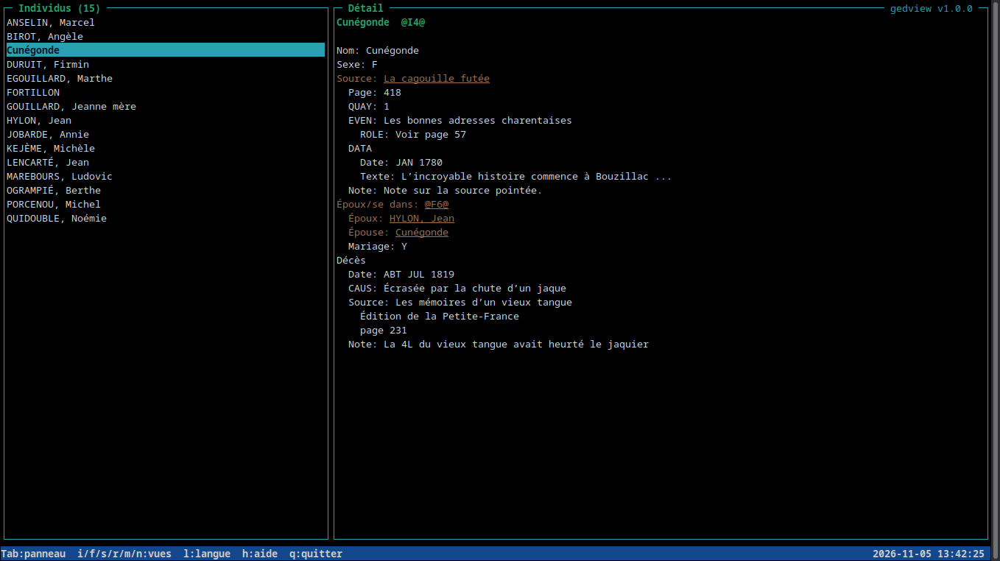
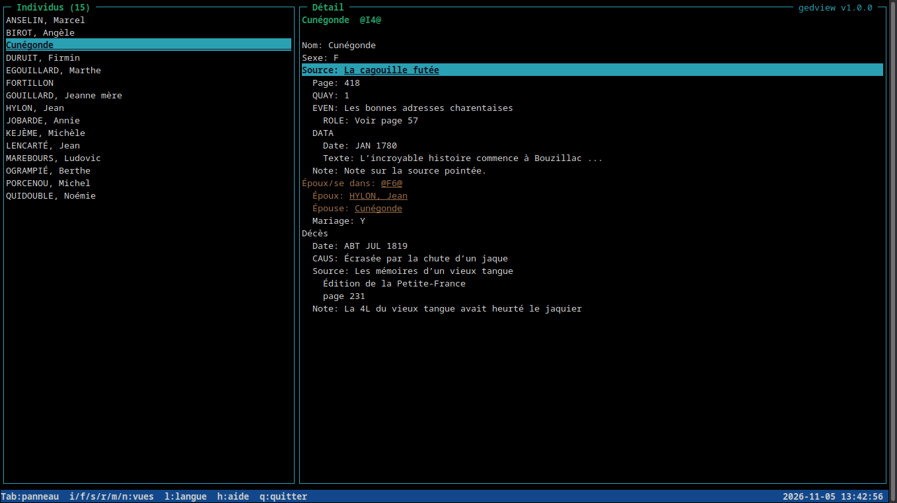
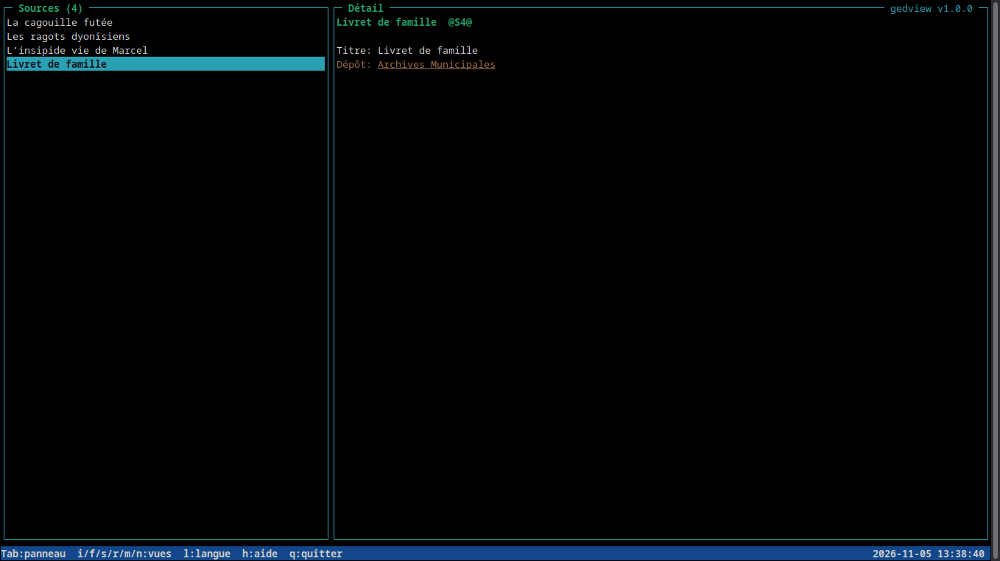
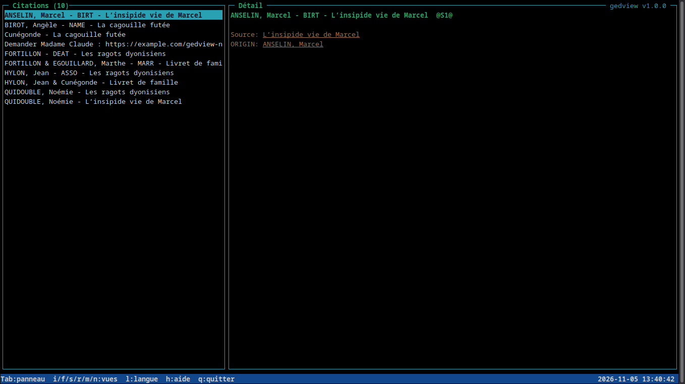
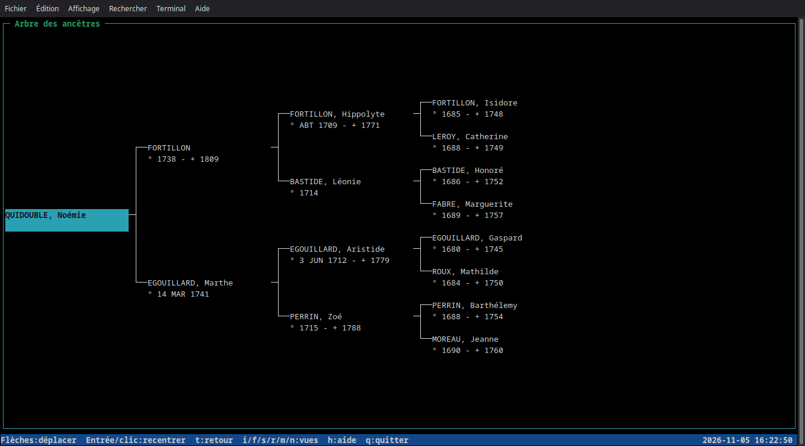
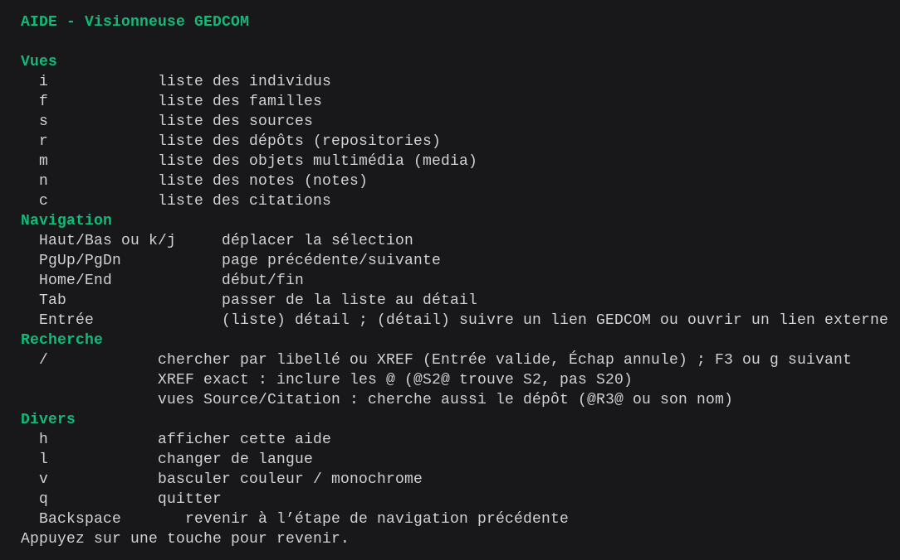

# gedview

Visionneuse de fichiers GEDCOM en C (ncurses), en mode texte.

## Aperçu

Captures réalisées avec le fichier d'exemple `gedcom-test.ged` (données fictives) dans un terminal à fond sombre.



Liste à gauche, détail à droite ; seul le texte cliquable est souligné en jaune. La barre d'état affiche l'aide rapide
et l'horloge, et le cadre du détail porte le nom et la version du programme.



`Tab` donne le focus au détail, où `Entrée` suit le lien sélectionné.



Recherche par dépôt dans la vue Sources : `/` puis `Archives Municipales` (voir [Touches](#touches)).





Arbre d'ascendance (touche `t`) : libellé et dates `° naissance - + décès` de chaque ancêtre ; `←` `→` `↑` `↓`
pour se déplacer, `Entrée` ou un clic pour recentrer l'arbre sur la case choisie (voir [Touches](#touches)).



## Fonctionnalités

- Listes des individus, familles, sources, dépôts, objets multimédia et notes.
- Toutes les vues sont triées par libellé.
- Noms d'individus affichés sous la forme `Nom, Prénom` lorsque le nom GEDCOM délimite le patronyme par des barres.
- Arbre d'ascendance horizontal centré (touche `t`) : libellé et dates `° naissance - + décès` de chaque ancêtre,
  navigable au clavier et à la souris ; un clic ou `Entrée` fait de l'ancêtre l'individu sélectionné.
- Reprise de la dernière session par fichier GEDCOM : vue affichée et sélection de chaque liste (individus, familles,
  sources, dépôts, médias, notes), mémorisées dans `$XDG_STATE_HOME/gedview/` (par défaut `~/.local/state/gedview/`).
- Vue des citations GEDCOM (`SOUR` imbriqués avec XREF), distincte des enregistrements Source.
- Panneau de détail avec liens cliquables entre enregistrements (conjoints, enfants, sources, dépôts...).
- Ouverture avec `xdg-open` des URL HTTP(S) dans les notes et des PDF/images référencés par les objets multimédia.
- Recherche par libellé ou XREF dans la liste affichée ; dans les vues Source et Citation, aussi par XREF ou nom du
  dépôt (`REPO`) de la source.
- Interface multilingue (en, fr, es, de, it, pt), changement de langue à la volée.
- Écrans colorés quand le terminal le permet, avec affichage monochrome de repli.
- Redimensionnement du terminal pris en charge ; un message indique quand il est trop petit.
- Date et heure toujours visibles à droite de la barre d'état (rafraîchies chaque seconde ; les secondes ne sont
  affichées que si le terminal fait au moins 100 colonnes) ; nom du programme et version dans le cadre du détail.
  La version provient des tags Git lorsqu'ils existent (voir [Publication](docs/releasing.md)).

## Prérequis

- Compilateur C (gcc) et `make`
- `ncursesw` (bibliothèque ncurses avec UTF-8) : paquet `ncurses-devel` (Fedora) ou `libncurses-dev` (Debian/Ubuntu)
- Pour ouvrir les liens externes et médias : `xdg-open` (paquet `xdg-utils` sur Debian/Ubuntu et Fedora)
- Pour l'entrée de menu avec sélecteur de fichier : `zenity` ou `kdialog` (optionnel, voir ci-dessous)

Les outils et commandes de développement sont détaillés dans le [guide de développement](docs/development.md).

## Compilation et lancement

```sh
make
./gedview gedcom-test.ged
./gedview -l de gedcom-test.ged   # force la langue
```

Le fichier GEDCOM passé au programme est ouvert en lecture seule : GedView ne le modifie jamais. Il doit être en
UTF-8. Les lignes mal formées ou orphelines sont ignorées avec un avertissement et un récapitulatif au démarrage.

## Entrée dans le menu des applications (Linux)

```sh
make install-desktop     # installation pour l'utilisateur courant, sans root
make uninstall-desktop   # désinstallation
```

Valable sur les bureaux Linux respectant la norme freedesktop.org (GNOME, KDE, XFCE...). La cible compile le
programme puis installe dans `~/.local/share/gedview/` (ou `$XDG_DATA_HOME/gedview/`) l'exécutable, `lang/` et le
lanceur `scripts/gedview-open`, et crée `~/.local/share/applications/gedview.desktop` à partir de
`scripts/gedview.desktop.in`. Les variables `APPDIR` et `DESKTOP_DIR` permettent de changer ces destinations.

L'installation est une copie : le programme y retrouve ses traductions dans le `lang/` installé à côté de
l'exécutable, et le dossier du projet n'est plus utilisé à l'exécution. Après une modification du code ou de `lang/`,
relancer `make install-desktop` pour mettre à jour la copie installée.

« GedView » apparaît alors dans le menu (terminal + sélecteur de fichier) et dans « Ouvrir avec » du gestionnaire de
fichiers pour les `.ged`. Sans argument, le lanceur ouvre un sélecteur de fichier avec `zenity`
(`sudo dnf install zenity` sur Fedora, `sudo apt install zenity` sur Debian/Ubuntu) ou, à défaut, `kdialog`. Un terminal
par défaut doit être configuré (`Terminal=true`). `update-desktop-database` (paquet `desktop-file-utils`) est utilisé
s'il est présent.

## Touches

| Touche | Action |
| --- | --- |
| `i` `f` `s` `r` `m` `n` `c` | individus, familles, sources, dépôts (repositories), multimédia (media), notes, citations |
| `↑` `↓` ou `k` `j` | déplacer la sélection |
| `PgUp` `PgDn` `Home` `End` | page précédente/suivante, début, fin |
| `Tab` | passer de la liste au détail |
| `Entrée` | (liste) ouvrir le détail ; (détail) suivre le lien souligné ou ouvrir une URL/un média |
| `Backspace` | revenir à l'étape de navigation précédente (lien, sélection ou vue) |
| `t` | (vue Individus) afficher/masquer l'arbre d'ascendance horizontal de l'individu courant |
| arbre : `←` `→` `↑` `↓` ou `k` `j` | aller à l'enfant, au parent (père d'abord), à la case précédente/suivante de la génération |
| arbre : `Entrée` ou clic gauche | recentrer l'arbre sur la case choisie, qui devient l'individu sélectionné (`Backspace` revient en arrière) |
| arbre : `←` sur la personne centrale | liste de ses enfants (`↑` `↓`, `Entrée` pour choisir, `Échap` ou `→` pour annuler) |
| `/` | rechercher dans la liste (`Entrée` valide, `Échap` annule) ; le texte est cherché dans le libellé ou l'XREF, sans tenir compte de la casse. Pour un XREF exact, inclure les `@` : `@S2@` trouve `S2` mais pas `S20`. Dans les vues Source et Citation, le XREF (`@R3@`) ou le nom du dépôt de la source est aussi cherché |
| `F3` ou `g` | résultat suivant pour la dernière recherche (`g` si F3 est interceptée, par exemple dans VS Code) |
| `l` | changer de langue |
| `v` | basculer entre affichage couleur et monochrome |
| `h` ou `F1` | aide |
| `q` | quitter |

## Documentation du projet

- [Architecture, arborescence et diagrammes](docs/architecture.md)
- [Développement, tests, Makefile et traductions](docs/development.md)
- [Calcul des versions et publication](docs/releasing.md)
- [Conventions de contribution et de test](AGENTS.md)

Pour compiler et lancer les tests : `make` puis `make test`. `make sanitize` relance les tests avec AddressSanitizer,
LeakSanitizer et UndefinedBehaviorSanitizer. Les autres cibles et leurs prérequis sont dans le
[guide de développement](docs/development.md).
