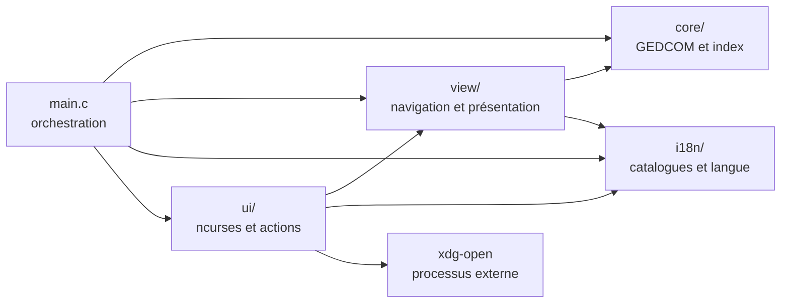
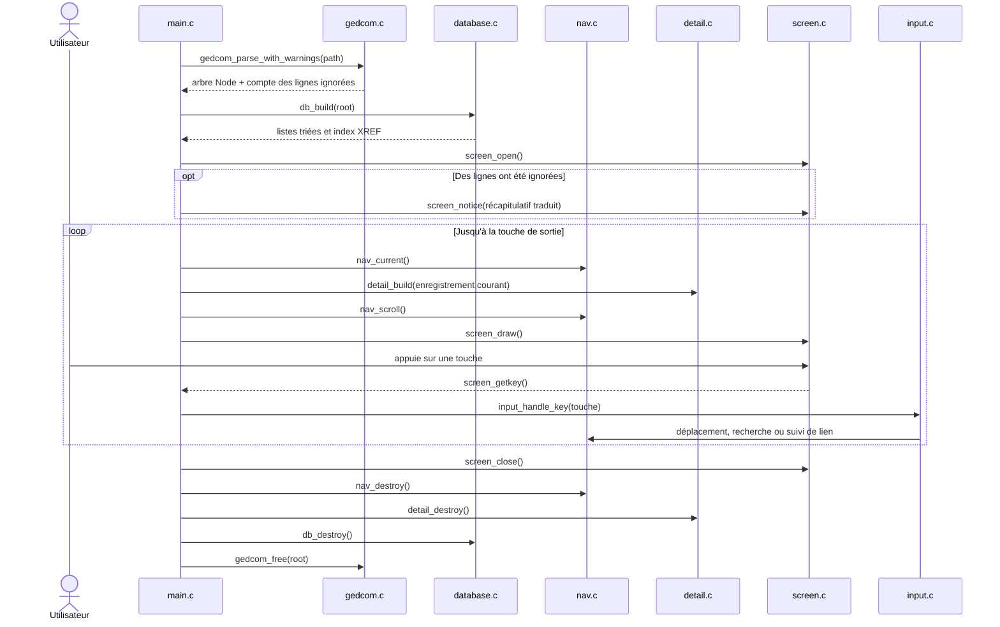

# Architecture de GedView

Cette page décrit les responsabilités des couches et le parcours d'un fichier jusqu'à l'écran.

## Dépendances entre couches



`core/` ne dépend ni de ncurses ni des traductions. `view/` transforme les données en listes, lignes de détail et état de navigation. `ui/` adapte ces éléments au terminal; ses actions d'interface sont injectées dans `input.c` via `InputHooks`, ce qui permet de tester le routage sans ncurses. La validation et la résolution des cibles externes sont séparées du lancement `xdg-open` et testées sans démarrer de processus externe.

## Organisation des fichiers

```text
src/
    main.c           arguments et boucle principale
    core/            données GEDCOM, sans ncurses ni traductions
        gedcom.c/h     structure Node et parsing
        records.c/h    types d'enregistrements et libellés
        database.c/h   listes d'enregistrements et index XREF trié
        version.c/h    version du programme (injectée par le Makefile depuis Git)
        state.c/h      mémoire entre sessions : valeurs nommées par fichier GEDCOM (fichier d'état XDG)
    i18n/            traductions
        i18n.c/h       langue courante, accès aux textes (repli sur l'anglais)
        catalog.c/h    lecture et validation des fichiers .lang
        langdir.c/h    recherche du dossier lang/ et liste des langues
    view/            présentation, sans ncurses
        detail.c/h     construction des lignes de détail
        nav.c/h        état de navigation (vue, sélection, défilement, recherche, liens)
        label.c/h      libellés affichables (texte de remplacement traduit)
        kindview.c/h   touche, titre et slot de mémorisation de chaque type de liste
        pedigree.c/h   arbre d'ascendance (cases numérotées 1, 2n, 2n+1), disposition et déplacements
        family.c/h     résumé d'un individu (libellé, dates) et liste de ses enfants
        treenav.c/h    actions de l'arbre sur Nav : ouverture, sélection, recentrage, liste des enfants
        session.c/h    reprise de la dernière session (vue et sélection de chaque liste) via core/state
    ui/              seul code qui utilise ncurses
        screen.c/h     fenêtres, dessin des listes et du détail, barre d'état, saisie de texte (ncurses)
        treeview.c/h   dessin de l'arbre, connecteurs, liste des enfants et clic de souris (ncurses)
        help.c/h       page d'aide (ncurses)
        input.c/h      touches -> actions ; les actions d'interface sont injectées (`InputHooks`), donc testable
        external.c/h   lancement sans shell de xdg-open
        external_target.c/h validation des URL et résolution canonique des chemins média
lang/              un fichier de traduction par langue
media/             image SVG et PDF d'exemple référencés par gedcom-test.ged
scripts/           coverage.sh (résumé gcov), gedview-open et gedview.desktop.in (entrée de menu)
tests/             tests unitaires (un fichier par module) et d'intégration, framework maison dans tests/support
```

## Parcours d'une session



Le panneau de détail est reconstruit après chaque action. La navigation suit les liens XREF entre enregistrements et garde un historique pour le retour arrière.

L'arbre d'ascendance (touche `t`) est un mode de la vue Individus porté par `Nav` (`tree`, `tree_sel`) : `pedigree.c` construit à la demande la grille des ancêtres de l'individu courant (premier `FAMC`, profondeur limitée à `PEDIGREE_MAX_GENS`, ce qui borne aussi les cycles) et résout les déplacements ; `treenav.c` applique les actions à `Nav` ; `treeview.c` dessine l'arbre, centré, avec ses connecteurs et enregistre les zones cliquables. Un clic de souris est traduit en numéro de case par le hook `mouse_pick` de `InputHooks`, puis `treenav_recenter` sélectionne l'ancêtre dans la liste et l'ajoute à l'historique. « ← » sur la personne centrale ouvre la liste de ses enfants (`family.c`) ; `Entrée` choisit l'enfant.

Au démarrage, `session_restore` relit la vue et la sélection de chaque liste (hors citations, sans XREF) pour le fichier ouvert ; `session_save` les écrit à la fermeture. `core/state.c` stocke des lignes `slot<tab>valeur<tab>chemin canonique` dans `$GEDVIEW_STATE_DIR`, sinon `$XDG_STATE_HOME/gedview`, sinon `~/.local/state/gedview` (fichier `last-person`).

## Données et propriété mémoire

- `gedcom.c` construit un arbre de `Node`; la racine possède ses nœuds et leurs chaînes. `gedcom_free` libère l'arbre.
- `database.c` construit des listes triées et un index XREF qui empruntent les `Node` de l'arbre. L'arbre doit donc rester vivant tant que `Database` est utilisé; `db_destroy` libère seulement les index et listes.
- `detail.c` construit un tableau de lignes de présentation possédé par `Detail`; `detail_destroy` le libère.
- `nav.c` possède l'historique de navigation; `nav_destroy` le libère.

À la fermeture, `main.c` libère le détail et la navigation, détruit la base, puis libère l'arbre GEDCOM.

## Particularités GEDCOM

La vue Citations est virtuelle : elle regroupe les nœuds `SOUR` imbriqués dont la valeur est un XREF. Les `SOUR` de niveau zéro restent des enregistrements Source. Tout préfixe de XREF est accepté; les citations sans XREF ne sont pas listées.

Les XREF d'enregistrements doivent être uniques. Les lignes mal formées ou sans parent valide sont ignorées avec un avertissement indiquant leur numéro de ligne; leur nombre est récapitulé avant l'ouverture de la navigation. La profondeur de parsing est limitée au niveau 62.
